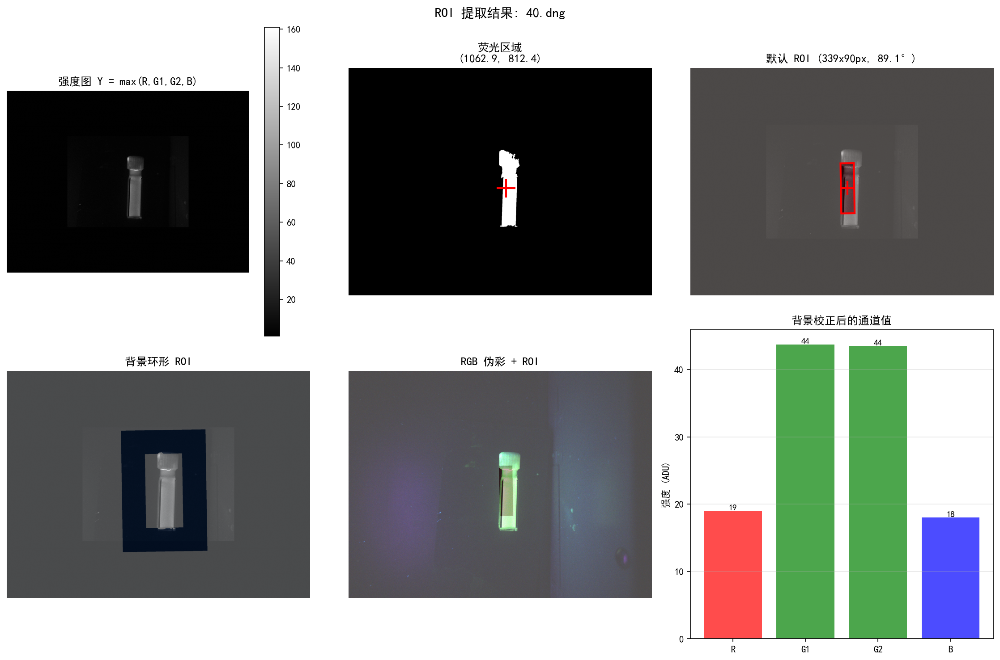

## 基于固定摄像头的荧光成像与算法开发

针对固定摄像头荧光成像场景，本文以 DNG/RAW 为输入，结合交互式 ROI 选区与背景扣除，构建面向“双峰”发射谱的通道比值特征，用于后续定量分析与浓度反演。与经过 ISP（图像信号处理器）处理的 JPEG/PNG 相比，RAW 数据保留了更接近线性的像素响应关系，有利于在不同曝光与环境漂移条件下进行可比对的定量计算。

### RAW 读取与 Bayer 四通道拆分

实验中使用固定摄像头采集 DNG 图像，算法侧采用 `rawpy` 直接读取 Bayer 原始阵列，并按 RGGB 模式拆分为四个子通道：

$$
\begin{aligned}
R &= I(2i,2j), \\
G_1 &= I(2i,2j+1), \\
G_2 &= I(2i+1,2j), \\
B &= I(2i+1,2j+1).
\end{aligned}
$$

其中 $I(\cdot)$ 表示 RAW 阵列像素值。为抑制暗电流与读出偏置，按通道黑电平 $\mathrm{BL}_X$（优先由 RAW 元信息读取）进行扣除并截断到非负：

$$
X'=\max(X-\mathrm{BL}_X, 0),\quad X\in\{R,G_1,G_2,B\}.
$$

同时读取白电平 $W$（14-bit RAW 常见默认值为 $16383$），并以 $0.95W$ 定义饱和阈值用于质量控制，避免非线性饱和导致特征失真。

### ROI 与背景环的几何定义

固定摄像头成像能显著降低视角与尺度变化，但样品放置仍可能存在平移与轻微旋转。为兼顾鲁棒性与可解释性，本文采用可旋转矩形作为 ROI（Region of Interest）：

$$
\mathcal{R}=(x_c,y_c,w,h,\theta).
$$

其中 $(x_c,y_c)$ 为中心，$w,h$ 为宽高，$\theta$ 为旋转角。背景采用“空心矩形环”（外框减去内框），并在几何上排除比色皿区域，从而在同一张图像内估计局部杂散光与暗背景：

$$
M_{\mathrm{BG}} = M_{\mathrm{outer}}\setminus M_{\mathrm{inner}}\setminus M_{\mathrm{ROI}}.
$$

下图给出了代码输出的可视化结果，包含亮度图、ROI/BG mask、叠加效果以及扣除背景后的通道柱状图。该程序实现支持一次交互选区后对整批图像复用，以匹配固定相机平台“几何稳定、批量处理”的实验流程。



### 统计量、背景扣除与通道比值

对 ROI 与背景环分别计算四通道统计量（均值、方差、分位数与饱和比例等），并以均值为主构建后续特征。设 $X\in\{R,G_1,G_2,B\}$，ROI 与背景的通道均值分别为 $\mu_{\mathrm{ROI},X}$ 与 $\mu_{\mathrm{BG},X}$，则背景扣除后的有效信号定义为：

$$
X_{\mathrm{corr}}=\max\left(0,\mu_{\mathrm{ROI},X}-\mu_{\mathrm{BG},X}\right).
$$

考虑到 Bayer 绿色通道存在 $G_1/G_2$ 两个采样位置，本文进一步采用

$$
\bar{G}=\frac{\mu_{\mathrm{ROI},G_1}+\mu_{\mathrm{ROI},G_2}}{2},\qquad
G_{\mathrm{corr}}=\frac{G_{1,\mathrm{corr}}+G_{2,\mathrm{corr}}}{2},
$$

并定义一组比值特征以抵消曝光、激发强度与光路效率的整体漂移：

$$
\mathrm{R/G}=\frac{\mu_{\mathrm{ROI},R}}{\bar{G}+\epsilon},\quad
\mathrm{B/G}=\frac{\mu_{\mathrm{ROI},B}}{\bar{G}+\epsilon},\quad
\mathrm{G_1/G_2}=\frac{\mu_{\mathrm{ROI},G_1}}{\mu_{\mathrm{ROI},G_2}+\epsilon}.
$$

其中 $\epsilon$ 为避免除零的小常数。特别地，$\mathrm{G_1/G_2}$ 可作为质量指示：当其显著偏离 $1$ 时，往往意味着照明不均匀、遮挡或图像存在局部异常，应触发重拍或重新选区。

### 面向“双峰”发射谱的 R–G 比值建模

本研究体系中，样品发光光谱具有典型“双峰”特征：一组峰主要落在相机绿色响应区，另一组峰主要落在红色响应区。因此，红绿通道在 ROI 内的相对强度可近似反映双峰两端的相对贡献。基于背景扣除信号，本文引入双峰相关的两类特征：

$$
\rho_{RG}=\frac{R_{\mathrm{corr}}}{G_{\mathrm{corr}}+\epsilon},\qquad
\delta_{RG}=\frac{G_{\mathrm{corr}}-R_{\mathrm{corr}}}{G_{\mathrm{corr}}+R_{\mathrm{corr}}+\epsilon}.
$$

其中 $\rho_{RG}$ 对应“双峰强度比”，$\delta_{RG}$ 则对应“归一化双峰偏置”，在整体亮度缩放下更稳定。结合 40.dng 示例，可见扣除背景后 $G_{\mathrm{corr}}$ 明显高于 $R_{\mathrm{corr}}$，对应双峰中绿色峰占优；同时 $G_1$ 与 $G_2$ 基本一致，说明 Bayer 绿色采样稳定。

进一步地，在一组以文件名标注浓度梯度的样本上，ROI 内绝对强度随浓度上升整体衰减，而 $\mathrm{R/G}$ 与 $\rho_{RG}$ 呈缓慢上升趋势（见下表），提示双峰相对权重随反应/浓度发生改变。该现象为后续定量模型提供了两条互补信息：**(i)** 由 $\ln(G_{\mathrm{corr}}+\epsilon)$ 或 $\ln(R_{\mathrm{corr}}+\epsilon)$ 表征的整体强度衰减；**(ii)** 由 $\rho_{RG}$ 或 $\delta_{RG}$ 表征的光谱形状变化。二者联合可在固定摄像头平台上实现对激发漂移与样品装载差异更不敏感的稳健估计。

| 文件名（浓度标注） | $\mu_{\mathrm{ROI},R}$ | $\mu_{\mathrm{ROI},\bar{G}}$ | $\mathrm{R/G}$ | $\rho_{RG}$（校正后） |
| --- | ---: | ---: | ---: | ---: |
| 0.2.dng | 35.30 | 80.85 | 0.437 | 0.431 |
| 40.dng  | 18.77 | 42.21 | 0.445 | 0.438 |
| 240.dng | 8.27  | 17.09 | 0.484 | 0.470 |

### 浓度反演结果与误差评估

在上述特征体系基础上，可进一步将 ROI 统计量映射为浓度，实现从固定摄像头荧光图像到定量指标的端到端推断。下图展示了留一法交叉验证（LOO-CV）条件下岭回归模型的预测结果，以及以单通道 $G_1$ 校正强度进行指数反演得到的对照结果。

以相对误差 $\mathrm{RE}=\mathrm{RMSE}/\text{满量程}$ 衡量：岭回归（LOO-CV）在全量程上的决定系数为 $R^2=0.983$，RMSE 为 $9.40\,\mu\mathrm{M}$，在满量程 $240\,\mu\mathrm{M}$ 下相对误差约 $3.9\%$；相比之下，$G_1$ 指数反演在可反演样本上的 $R^2=0.949$，RMSE 为 $12.61\,\mu\mathrm{M}$，在同一满量程下相对误差约 $5.3\%$。


### 算法流程伪代码

#### 1) 采集 RAW 元数据与 Bayer 四通道拆分（`pic_RGB/roi_processor.py`）

```text
Input:
  - DNG file path p
Output:
  - RAW tensor I_raw ∈ R^{H×W×4} (R, G1, G2, B)
  - Metadata dict M (white_level, black_level, ...)

1. raw ← rawpy.imread(p)
2. M.white_level ← raw.white_level
   - fallback: raw.camera_white_level_per_channel
3. bl ← raw.black_level_per_channel
   - fallback: raw.camera_black_level_per_channel
   - else: bl = [0,0,0,0]
4. I ← float32(raw.raw_image)
5. Split RGGB and subtract black level:
   - R  = I[0::2,0::2] - bl0
   - G1 = I[0::2,1::2] - bl1
   - G2 = I[1::2,0::2] - bl2
   - B  = I[1::2,1::2] - bl3
6. Clamp to non-negative: R,G1,G2,B ← max(·, 0)
7. I_raw ← stack(R, G1, G2, B)
8. return I_raw, M
```

#### 2) 物理特征构建（`concentration/physics_features.py`）

```text
Input:
  - One-sample statistics row (ROI means, optional BG means, roi_G1_var, ...)
  - g_mode ∈ {g1, avg}
  - eps, s_min
Output:
  - Feature vector x = [ln R, ln G, ln B, R/G, B/G, Var_G]

1. Parse y (true concentration) from filename (for training/evaluation only)
2. Select green mean:
   - G ← roi_G1_mean
   - if g_mode=avg: G ← (roi_G1_mean + roi_G2_mean)/2
3. If background subtraction enabled and bg_* columns exist:
   - R ← max(roi_R_mean - bg_R_mean, s_min)
   - G ← max(G - bg_G_mean, s_min)   # bg_G_mean consistent with g_mode
   - B ← max(roi_B_mean - bg_B_mean, s_min)
   else:
   - R ← roi_R_mean; B ← roi_B_mean
4. Intensity (Beer–Lambert) terms:
   - ln R = ln(R + eps), ln G = ln(G + eps), ln B = ln(B + eps)
5. Bimodal/color ratios:
   - R/G = R/(G + eps), B/G = B/(G + eps)
6. Var_G ← roi_G1_var (or averaged var if g_mode=avg)
7. return x
```

#### 3) 岭回归训练、单调校准与留一法评估（`concentration/rgb_exponential_fit.py`）

```text
Input:
  - Feature matrix X ∈ R^{N×d}, true concentration y ∈ R^N
  - Alpha grid {α}, weight smoothing eps_w
Output:
  - StandardScaler + RidgeCV model, Isotonic calibrator, LOO-CV metrics

1. Sample weights:
   - w_i ← 1/(y_i + eps_w), normalize so mean(w)=1
2. Train pipeline (with weights):
   - f̂ ← StandardScaler ∘ RidgeCV({α})
   - fit f̂ using (X, y, w)
3. Raw prediction and clamp:
   - ỹ ← max(f̂(X), 0)
4. Monotonic calibration:
   - g ← IsotonicRegression
   - fit g with (ỹ, y, w)
   - y_cal ← max(g(ỹ), 0)
5. Leave-One-Out CV (unbiased):
   - for each test sample k:
       train Ridge + Isotonic on remaining samples
       predict y_pred^(k) for sample k
6. Compute R^2 / RMSE on LOO-CV predictions and save prediction table for error analysis
```

### 小结

综上，本文在固定摄像头荧光成像平台上，围绕“双峰”光谱特征构建了基于 RAW 四通道统计与 R–G 比值的特征体系：以背景扣除保证信号可比性，以通道比值降低整体漂移敏感性，并以 $G_1/G_2$ 一致性与饱和比例作为质量控制指标。上述处理结果以 CSV/JSON/NPY 形式落盘，为后续回归建模与单调校准提供了可追溯的数据接口。
